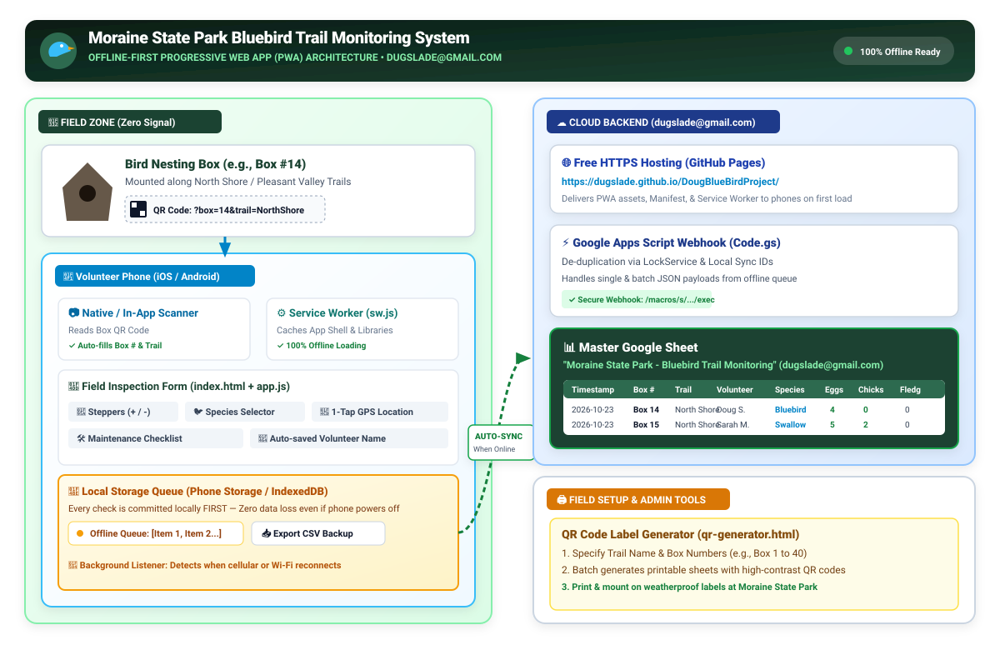

# Moraine State Park Bluebird Trail Monitoring System

An offline-first, mobile Progressive Web App (PWA) for Moraine State Park volunteers to monitor Eastern Bluebird nesting boxes in the field, designed specifically to solve cellular dead zones with automatic offline storage and background Google Sheets synchronization.

---

## 🌟 Key Features

1. **100% Offline Capability (Service Worker + Cache):**
   - Works seamlessly with zero cellular or Wi-Fi signal in the park.
   - Volunteers can install it directly to their iPhone or Android home screen with 1 tap (*"Add to Home Screen"*).
2. **Instant QR Code Scanning:**
   - Scan box QR codes with the phone's native camera or using the built-in in-app camera scanner.
   - Pre-fills Box Number and Trail Zone instantly.
3. **Interactive Trail Map (🗺️):**
   - Interactive Leaflet map displaying all bluebird box locations across **North Shore** and **South Shore**.
   - **"📍 My Location"** real-time GPS tracker showing volunteer position walking along the trail.
   - Tapping any box pin opens its details and a **"📝 Log Inspection"** button that pre-fills the form for that box.
   - Reads directly from the dedicated **"Box Locations"** master registry in Google Sheets and caches offline!
4. **Zero Configuration for Volunteers:**
   - The master Google Apps Script webhook URL is embedded directly into the app. Volunteers never need to configure settings.
5. **Optimized for Field Use:**
   - Large tap targets and +/- stepper buttons for rapid logging with one thumb.
   - Auto-remembers volunteer name so they never have to re-type it.
   - 1-tap GPS coordinates capture.
6. **Zero-Loss Data Queue & Auto-Sync:**
   - Every inspection is saved locally on the device first.
   - When the phone reconnects to cell service or home Wi-Fi, it automatically syncs all pending checks to your Google Sheet under `dugslade@gmail.com`.
7. **Offline CSV Backup:**
   - Volunteers or coordinators can download a full `.csv` backup of all checks directly from their phone anytime.
8. **Printable QR Code Generator (`qr-generator.html`):**
   - Built-in generator to print weatherproof QR code stickers/labels for all Moraine boxes.
9. **Species & Nest Identification Guide:**
   - In-app guide with field identification photos (males & females) for Eastern Bluebirds, Tree Swallows, House Wrens, Chickadees, Tufted Titmice, and invasive House Sparrows.
10. **Hiker Welcome Screen & 3-Digit Passcode Gate (`258`):**
    - **Curious Hikers:** Scanning a box QR code displays a welcoming educational card explaining Moraine State Park's bluebird conservation program, nesting season, and a gentle reminder not to disturb the nest box.
    - **Volunteer Monitors:** Entering the 3-digit PIN code (`258`) unlocks the full field inspection form. The authorization is remembered across all boxes during trail monitoring.
    - **Settings Controls:** Easily lock the device or test the hiker experience at any time from the Settings tab.

---

## 🏗️ System Architecture



---

## 📁 Project Structure

```
DougBlueBirdProject/
├── index.html                  # Main PWA mobile app interface
├── styles.css                  # Responsive field-optimized styling
├── app.js                      # Core offline storage, sync, map, & scanner logic
├── sw.js                       # Service Worker for offline caching (v1.0.2)
├── manifest.json               # Web App Manifest for mobile installation
├── qr-generator.html           # Tool to generate & print box QR labels
├── Moraine_Box_Locations_Starter.csv # Starter CSV template for box registry
├── architecture.svg            # System architecture vector diagram
├── architecture.png            # High-resolution architecture graphic
├── icons/                      # App icons for iOS & Android
│   ├── icon.svg
│   ├── icon-192.png
│   └── icon-512.png
├── lib/                        # Offline standalone JavaScript libraries
│   ├── html5-qrcode.min.js     # Live camera QR scanner engine
│   ├── qrcode.min.js           # QR code generator library
│   └── leaflet/                # Offline Leaflet map engine, CSS, & pin assets
└── google-apps-script/
    └── Code.gs                 # Webhook backend script for dugslade@gmail.com
```

---

## 🗺️ Interactive Trail Map & "Box Locations" Registry

The system separates the **Box Locations Registry** from the **Daily Inspections Log** to keep both clean and organized.

### 1. The "Box Locations" Master Sheet (Google Sheets)
In your Google Sheet, the **"Box Locations"** tab contains the permanent registry of all nesting boxes in the park:

| Box Number / Code | Trail / Area | GPS Coordinates | Description / Location Notes | Status |
| :--- | :--- | :--- | :--- | :--- |
| `Box 1` | `North Shore` | `40.963124, -80.085432` | Near North Shore Trailhead kiosk | Active |
| `Box 2` | `North Shore` | `40.964210, -80.083150` | Open meadow near mile marker 0.3 | Active |
| `Box 3` | `North Shore` | `40.965840, -80.081200` | East of bicycle rental pavilion | Active |
| `Box 4` | `South Shore` | `40.942150, -80.098450` | Pleasant Valley picnic area | Active |
| `Box 5` | `South Shore` | `40.940890, -80.095320` | South Shore boat launch shoreline | Active |

- **Header Styling:** Styled in dark navy blue (`#002D9C`) with bold white text.
- **Dropdown Validations:**
  - `Trail / Area`: Restricted to **`North Shore`** and **`South Shore`**.
  - `Status`: Restricted to **`Active`**, **`Needs Repair`**, and **`Inactive`**.
- **GPS Coordinates Format:** Enter as decimal degrees: `Latitude, Longitude` (e.g. `40.963124, -80.085432`).

### 2. How the Trail Map Works in the App
- **Live Visual Map:** Opens centered on Moraine State Park / Lake Arthur.
- **Color-Coded Numbered Pins:**
  - 🔵 **Blue Badges:** North Shore boxes.
  - 🟢 **Green Badges:** South Shore boxes.
- **Trail Filters:** 1-tap filter buttons (`All Boxes`, `North Shore`, `South Shore`) to focus on a specific trail section.
- **📍 "My Location" Button:** Activates phone GPS to display a pulsing live dot showing the volunteer's exact location on the trail.
- **Tap-to-Log Action:** Tapping any pin shows the box number, trail, description, GPS coordinates, and a big button: **"📝 Log Inspection"**. Clicking it automatically switches to the inspection form with that box pre-filled!
- **100% Offline Capability:** Box locations and map assets are stored in local phone storage, so volunteers can navigate the map even with zero cell service in deep hollows.
- **🔄 "Refresh Pins" Button:** When you add or move boxes in your Google Sheet, volunteers can tap Refresh Pins while online to update their phone's local map cache.

---

## 🧪 Diagnostics & "Test Sync Webhook" Explained

The system includes testing utilities to verify data flow:

### 1. In Google Sheets (`🐦 Bluebird Trail` → `🧪 Test Sync Webhook`)
- **What it does:** Runs an internal health check inside the Google Sheet script engine.
- **Why it's useful:** Confirms that the Apps Script has proper authorization to access the spreadsheet and is ready to process incoming HTTP webhooks from volunteers.

### 2. In Mobile App (`⚙️ Settings` → `🧪 Test Connection`)
- **What it does:** Sends a live test ping (`action: 'ping'`) from the phone over the internet to your Google Apps Script URL.
- **Why it's useful:**
  - Verifies that your Web App URL is correctly deployed and reachable.
  - Confirms that network requests can pass through without permission or firewall errors.
  - Displays a green confirmation toast: *"✅ Webhook reached! Check your Google Sheet"*.

---

## 📱 How New Volunteers Access & Prep the App

Because web browsers need to download the app files at least once while online to store them in the phone's offline cache, here are the 3 best ways to prepare volunteers:

### 1. Pre-Season Email / Text (Recommended)
Send volunteers a quick message before they head out for the season:

> *"Hi Team! Before heading out to Moraine State Park, please open this link on your phone while connected to Wi-Fi:*  
> 👉 **`https://dugslade.github.io/DougBlueBirdProject/`**  
> *Tap **Share → Add to Home Screen** (iPhone) or **Install App** (Android). The app will now work anywhere in the park, even without cell service!"*

### 2. Trailhead / Parking Lot "Start Here" QR Code
Most park parking lots and boat launches (e.g. McDanels Launch, Pleasant Valley) have at least basic cell signal, whereas deep wooded trails do not.
- Place a **"Welcome / Start Here" QR code** on the trailhead bulletin board or parking kiosk.
- Volunteers scan it once at their car before walking the trail. That 2-second scan downloads and locks the app into their phone's offline cache.

### 3. Automatic Caching on First Box Scan
If a new volunteer forgets to prep ahead of time, the moment they scan **any box** where they have even 1 bar of signal:
- The app loads.
- The **Service Worker silently saves the entire app into phone storage** in the background.
- As they walk deeper into the woods where signal drops to zero, all subsequent box scans will automatically load from their local cache instantly!

---

## 📲 How to Install on Phone (5 Seconds)

| **iPhone (Safari)** | **Android (Chrome)** |
| :--- | :--- |
| 1. Open the URL in Safari | 1. Open the URL in Chrome |
| 2. Tap the **Share** button (box with up arrow ⎋) | 2. Tap the **3 dots** (⋮) in top right |
| 3. Tap **"Add to Home Screen"** | 3. Tap **"Install App"** or **"Add to Home screen"** |

**Benefits after installing:**
- Bluebird app icon appears on their home screen.
- Launches full-screen like a native app (no browser search bar).
- Opens **instantly without internet**.
- Scanning any box QR code opens directly into the app.

---

## 🚀 Setup Guide (Connecting to `dugslade@gmail.com`)

### Step 1: Set Up Your Master Google Sheet

1. Open [Google Sheets](https://sheets.google.com) signed in as **`dugslade@gmail.com`**.
2. Create a new blank spreadsheet and name it:
   **`Moraine State Park - Bluebird Trail Monitoring`**
3. In the top menu, click **Extensions → Apps Script**.
4. In the Apps Script editor:
   - Delete any placeholder code.
   - Copy and paste the entire contents of [`DougBlueBirdProject/google-apps-script/Code.gs`](google-apps-script/Code.gs).
   - Click the **Save** (💾) icon.

### Step 2: Initialize Sheet Tabs via Custom Menu

1. In the Apps Script toolbar dropdown at the top, select **`setupBoxLocationsTab`** and click **▶️ Run**.
2. Switch to your Google Sheet — the **"Box Locations"** tab will be created with navy blue headers, dropdown rules, and starter boxes.
3. Refresh your Google Sheet tab in browser — you will now see the **`🐦 Bluebird Trail`** menu at the top:
   - `📍 Setup / Format "Box Locations" Tab`
   - `📝 Setup / Format "Inspections" Tab`
   - `🧪 Test Sync Webhook`

### Step 3: Deploy the Webhook

1. In Apps Script, click **Deploy → New deployment** (or **Manage deployments** → **Edit**).
2. Click the gear icon next to "Select type" and choose **Web app**.
3. Configure settings:
   - **Description:** `Moraine Bluebird Sync`
   - **Execute as:** `Me (dugslade@gmail.com)`
   - **Who has access:** `Anyone` *(allows volunteers' phones to submit without needing a Google login)*
4. Click **Deploy**.
5. Click **Authorize access** and select your `dugslade@gmail.com` account. *(Click "Advanced" → "Go to Untitled project (unsafe)" if prompted by Google)*.
6. Copy the **Web App URL** (starts with `https://script.google.com/macros/s/.../exec`).

---

## 🌐 Free HTTPS Hosting via GitHub Pages

To allow volunteers to access the app URL on their phones:

1. Go to your repository on GitHub:
   [https://github.com/dugslade/DougBlueBirdProject/settings/pages](https://github.com/dugslade/DougBlueBirdProject/settings/pages)
2. Under **Build and deployment**:
   - **Source:** `Deploy from a branch`
   - **Branch:** Select `main` and folder `/ (root)`
3. Click **Save**.
4. GitHub provides your permanent free HTTPS URL:
   👉 **`https://dugslade.github.io/DougBlueBirdProject/`**

---

## 🖨️ Printing Box QR Codes

1. Open [`DougBlueBirdProject/qr-generator.html`](qr-generator.html) in your browser.
2. Enter your live PWA URL (e.g. `https://dugslade.github.io/DougBlueBirdProject/`).
3. Select your Trail Area (`North Shore` or `South Shore`) and box numbers (e.g., `Box 1` to `Box 30`).
4. Click **Generate Labels** and then **Print Labels**.
5. Affix the weatherproof/laminated labels to the side or front of each box.

---

## 📝 Volunteer Field Inspection Workflow

1. **At the Bird Box:**
   - Volunteer points their phone camera at the QR code on the box (or taps the box on the **🗺️ Trail Map**).
   - The app opens with Box Number and Trail already filled in.
   - Volunteer logs:
     - Species & Box Status
     - Egg count & Chick count (using `+` / `-` buttons)
     - Chick stage (Hatchling / Pin Feathers / Feathered)
     - Maintenance notes / comments
   - Taps **Save Inspection Check**.
2. **Automatic Sync:**
   - If offline: Data is saved safely into phone storage with a yellow badge.
   - When signal is restored: Data automatically syncs into your master Google Sheet under `dugslade@gmail.com`.
